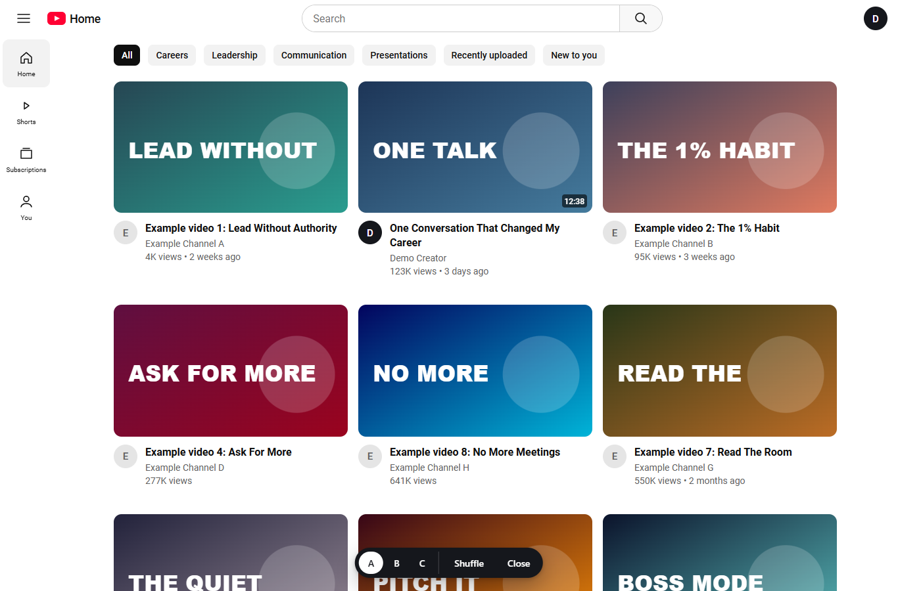

# YouTube homepage preview

See a thumbnail the way a viewer meets it. Each candidate shows as a home-feed card, and **View on homepage** opens a full home feed with your card in the first row among other videos, so you can judge how it stands out.



## What you get

- **A card.** A rounded 16:9 thumbnail with a duration badge, the channel avatar, a bold two-line title, the channel name and a views line.
- **A homepage preview.** A full-screen home feed with a top bar, category chips, a slim side menu and a three-column grid (two on a tablet, one on a phone). Your card sits in the middle of the first row.
- **Controls.** Switch between your thumbnails (A, B, C), shuffle the other videos, and close.

It only draws on the page. It never contacts YouTube, needs no account and saves nothing.

## Try it

Open `demo.html` in a browser. Everything in it is made up, including the thumbnails, which are drawn as SVG.

## Use it

```html
<link rel="stylesheet" href="src/youtube-preview.css">
<script src="src/youtube-preview.js"></script>
<script>
  // one card
  el.innerHTML = YouTubePreview.card({ image, title, channel: 'Your Channel', stats: '123K views • 3 days ago', duration: '12:38', mine: true });

  // the homepage preview
  YouTubePreview.openHomepage({
    candidates: [{ label: 'A', image, title, channel }, { label: 'B', image: imageB, title, channel }],
    references: [{ image, title, channel, views: 346951, published: '2026-03-17' }],  // other videos to fill the feed
  });
</script>
```

Every option is described at the top of `src/youtube-preview.js`. To bring it into another app with an AI's help, point it at [`ADAPT.md`](ADAPT.md).

## How it was built

In CareerOS this sits in the thumbnail workspace, where a video has three thumbnail positions (Main, B and C). The other videos in the feed come from the creator's own saved inspiration: videos they asked their assistant to save, and the thumbnail-format references they use for their visual style. A reference shows views and age only when those were saved with it, so nothing in the feed is invented. The creator's own card can show fixed example values (views and a duration) so they can check how the badge and the views line sit against the thumbnail's text.

## Files

| File | What it is |
|---|---|
| `src/youtube-preview.js` | The card and the homepage preview. No dependencies. |
| `src/youtube-preview.css` | All the styles, scoped to `.yc` and `.yh`. |
| `demo.html` | A working page with made-up data. |
| `ADAPT.md` | Instructions for an AI fitting this into another app. |
| `tests/test_demo.py` | A browser test of the demo. |

Not affiliated with or endorsed by YouTube.
